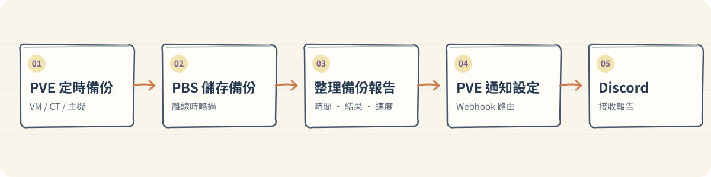
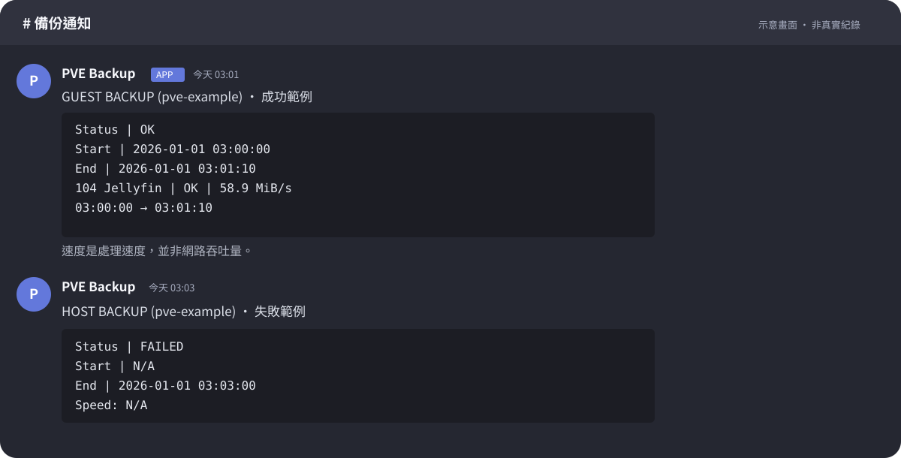

# PVE 備份 Discord 報告

自動把 PVE 的備份結果整理成表格，送到 Discord。

報告包含 **成功或失敗、開始與結束時間、可取得的處理速度**。PBS 離線時會跳過，不發通知，也不會自動補跑。

## AI agent：安裝與維護

1. 準備備份服務與 Discord Webhook。
2. 取得倉庫，安裝並測試報告程式。
3. 執行備份，核對 Discord 報告。

👉 [安裝、更新、驗證與回復步驟](docs/install.md)

🔎 [程式流程與追蹤範圍](docs/flows/README.md)

兩台 PVE 各執行自己的程式；**GitHub 更新不會自動部署**。PBS 只儲存備份，不執行本程式。PVE 測試 VM 已演練安裝與模擬通知；實際備份服務、Webhook 和 PBS 需另行設定及驗證。

> Webhook 網址、密碼與金鑰請留在 PVE，勿提交至 GitHub。

## Discord 通知範例

以下為模擬畫面與數值，實際名稱、格式及速度依環境而異。

